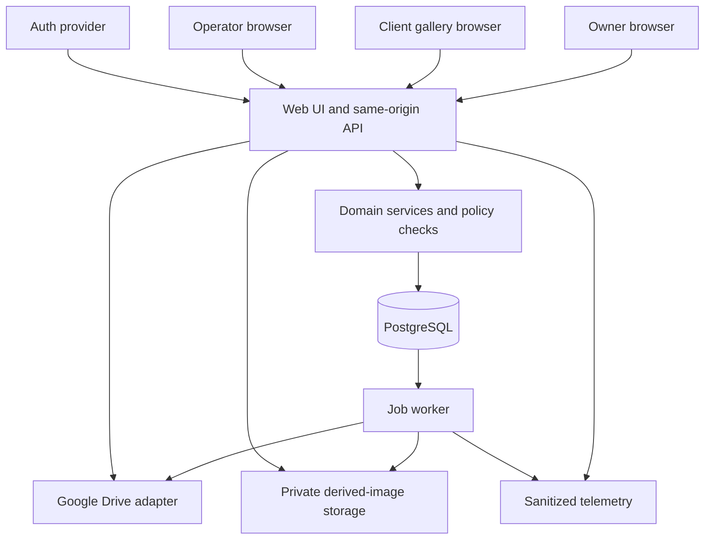

# Architecture

Status: target design with a verified provider-independent BL-003 foundation and BL-004 [app-side onboarding subset](auth/BL-004-EVIDENCE.md). Health, `/api/v1/me`, `/api/v1/onboarding` and setup/access pages exist; auth remains unconfigured and owner handlers fail closed. No provider/session schema was guessed. Domain and HTTP code live under modules/onboarding; Next-specific navigation lives under app/_lib to keep the compiled worker independent of Next browser/server routing imports. BL-001/002 spikes remain isolated. Related: [ADR-001](decisions/ADR-001-modular-monolith.md), [Database](DATABASE.md), [API](API.md).

## Baseline stack and unresolved providers

| Concern | Baseline | Status |
|---|---|---|
| Web and API | TypeScript, Next.js; same-origin browser/API deployment | Local Next 16.4.1 / React 19.3.1 / TS 5.9.3; Node 24.18.0 / npm 11.16.0 pinned; BL-004 me/onboarding routes built, other business endpoints pending |
| Persistence | PostgreSQL with explicit migrations and transactions | Initial app schema/transactions verified on isolated PostgreSQL 18.4; managed host and provider-owned auth schema undecided |
| Authentication | Conditional Better Auth/PostgreSQL server-session candidate; Auth0 managed fallback | DEC-001 OPEN/PARTIALLY VALIDATED; [ADR-006](decisions/ADR-006-auth-session-postgres-validation.md) supplements ADR-004; 18 memory + 5 real local PG checks with synthetic identities/mail, no Next auth integration/live provider; durable app guard and schema gaps remain |
| Source inventory | Google Drive adapter using supported APIs | DEC-002 OPEN/PARTIALLY VALIDATED: [ADR-007](decisions/ADR-007-drive-source-credentials.md), conditional studio OAuth with public-only fallback; [candidate contract](drive/ADAPTER_CONTRACT.md), 29 historical synthetic checks; live evidence and approved scope/cache policy pending |
| Async work | PostgreSQL-backed jobs, worker from the same repository | Local claim/lease/fencing/retry infrastructure verified; all real handlers explicitly unconfigured; no Redis |
| Derived assets | Private object storage plus controlled media endpoint | DEC-003 OPEN/PARTIALLY VALIDATED: [ADR-008](decisions/ADR-008-hosting-postgres-private-storage.md), conditional Render Singapore web/worker/PG18 + private S3 Singapore, R2/Railway alternatives; no provider infrastructure verified |
| Operations | Structured logs, counters, error reporting, health checks | Baseline; vendor undecided |

Do not infer this stack from the competitor's dependency versions. Framework/hosting selection must support server-side authorization, streaming, background workers and secret management.

DEC-003's [current evidence](hosting/DEC-003-EVIDENCE-2026-10-18.md) and [candidate environment/release contract](hosting/CONFIGURATION_CONTRACT.md) supplement ADR-005's historical hosting proposal. Five local real-socket HTTP checks and two valid-image decoder cases are distinct from provider proof. Same-artifact web/worker, separately authorized migrator, source SQL packaging, role/pool budgets and private derived storage remain the target. No production topology is approved: owner budget/location unset; hosted proxy/worker/Linux/native/TLS/IAM/backup/logging remain unverified. No API/schema/eligibility change; the 40 MP spike parameter is not a product limit.

## Components

Boundaries inside one codebase:

| Module | Owns | Must not do |
|---|---|---|
| Identity/tenancy | Provider mapping, studio membership and operator grants | Accept arbitrary client tenant ownership |
| Onboarding | Atomic/default initialization and recovery | Reset an existing trial on retry |
| Entitlements | Grant evaluation and studio write limits | Derive access from UI flags |
| Projects | Configuration, share token, archive and lifecycle | Mutate confirmation snapshots |
| Inventory | Drive traversal, metadata/versioning and availability | Use filename as identity |
| Gallery access | Menu grants, password checks, expiry/revocation | Expose provider credentials/source roots |
| Selection | Draft revision, quotas, notes, confirm/reopen | Resolve an arbitrary photo outside project scope |
| Delivery | Authorized image/download responses | Proxy arbitrary request URLs |
| Operations | Jobs, audit records, diagnostic projections | Provide unrestricted operator database editing |

Current layout: `src/app` for status/health, `src/modules/tenancy` and `src/modules/reliability` for scoped repositories/infrastructure, `src/adapters` for fail-closed interfaces, `src/db` for SQL/migration/pool and `src/worker` for the dispatcher. `tests` contains unit/actual PostgreSQL checks. Domain services/transport for later backlog features still need implementation. Route handlers remain thin; server actions, if used, invoke the same authenticated services.

## Request path and consistency

1. Validate the session or gallery grant and parse bounded input.
2. Resolve tenant/project ownership from canonical records.
3. Evaluate entitlement, archive/suspension, workflow/password/deadline and operation permissions.
4. Execute domain mutation under transaction/revision checks.
5. Persist audit/job/idempotency records in that transaction when required.
6. Commit before returning success. Acknowledge canonical IDs/revisions, not assumed local state.

Frontend optimistic state is visibly pending until acknowledged. Selection/config state is never trusted for authorization. Session verification and authorization belong at protected entry points and the data-access boundary, consistent with the [Next.js authentication guidance](https://nextjs.org/docs/app/guides/authentication). Provider-specific callback details remain gated by DEC-001.

Creation returns 201 as soon as the durable project and inventory job exist. The gallery shows preparing until initial indexing succeeds. The worker does not hold a database transaction open during external network requests.

## Inventory and caching

Provider adapter accepts a validated folder/file ID, never a caller-controlled URL. Folder listing must handle pagination, parent context and supported types through the [Drive API search/list model](https://developers.google.com/workspace/drive/api/guides/search-files). Authentication requirements, Shared Drive behavior and resource keys are DEC-002 acceptance criteria, not assumptions.

BL-002's [candidate contract](drive/ADAPTER_CONTRACT.md) defines root depth zero, explicit skip counts, page/entry/folder/time budgets, resource-key propagation and incomplete-scan failure. Only normalized synthetic inputs have been tested. Existing API/schema cannot yet retain root/child keys or studio credential ownership; integrate paired contracts after access-mode choice. API-visible completeness is not a provider snapshot or proof of hidden descendants.

The 18 October [DEC-002 investigation](drive/DEC-002-EVIDENCE-2026-10-18.md) adds a candidate connection/version/secret lifecycle and paired pending API/Database extensions, without changing runtime/schema. Folder metadata can remain readable while child listing is denied and empty; require fresh `capabilities.canListChildren` for each traversed folder. Current spike descriptors omit this field. Keep live sources/cache disabled until dedicated-provider evidence, supported-mode disposition and scope/cache approvals exist; neither OAuth documentation nor the existing seven-day retention proposal closes the gate.

An inventory generation is published only after a complete bounded scan. Interrupted scans do not tombstone old files. Stage bounded scan metadata in private job storage keyed by generation; publish stable-ID upserts and availability changes together under the project/selection locks, then update `last_successful_sync_at`. Readers continue using the last complete generation until commit. Abort and report limit errors at configured ceilings; clean abandoned staging objects through retention jobs.

Cache key: studio ID + project ID + provider file ID + source version + transform version + target size. Source version changes invalidate derived images. Cached source availability is never sufficient authorization. Serve through a same-origin media endpoint that checks the current grant; private caches must not bleed between sessions/tenants. MVP thumbnails are browser-private and revalidated; don't add a public CDN cache until its authorization/invalidation design is reviewed.

Download original via bounded streaming after provider-ID resolution and grant checks. Recheck source accessibility and fail clearly on permission loss. The initial implementation must prove hosting supports timeouts, streaming and file-size caps before offering downloads.

The BL-002 experiment preflights bounded upstream bytes into private transient scratch before returning a success handle, then rechecks policy before reading. This is a candidate approach for upstream overflow/truncation, not an implemented media route. Production still needs actual provider version/access checks, pinned decoder resource limits, scratch admission/ACL/crash cleanup, downstream cancellation and proxy evidence. Scratch must never hold durable acknowledged state.

## Jobs and deployment units

Two deployable processes share domain code: web and worker. PostgreSQL is the durable job queue. Inserting a job in the business transaction avoids a separate outbox for MVP. Worker claims with a lease, tracks attempts and renews for long jobs; only one active job per project/type dedupe key is allowed. Use bounded concurrency and provider-aware backoff, not unbounded parallel downloads.

Handlers: `inventory_scan`, `thumbnail_generate`, `project_purge`, `cache_cleanup`, `expired_session_cleanup`, `retention_cleanup`. Proposed retry delays: 5 s, 30 s, 2 m, 10 m, 30 m with jitter; permanent permission/validation failures stop early. Exhausted jobs become failed with safe retry controls. A duplicate worker execution must be harmless.

BL-002 calculates an initial attempt plus at most five retries with positive jitter and respects later Retry-After hints. BL-003 now verifies this queue schedule on PostgreSQL, with released waiting leases, lease-token fencing and atomic publication/completion helpers. It also tests real killed-process recovery and renewal. Actual inventory publication must still validate generation/config and source/grants in BL-007; these helpers do not implement inventory or any other job handler. See [foundation evidence](foundation/BL-003-EVIDENCE.md) and [Drive evidence](drive/BL-002-EVIDENCE.md).

## Monitoring and scaling decisions

Collect API latency/error rate, selection conflicts, confirmation success, queue age/depth, inventory duration, Drive throttling, thumbnail failures and database pool saturation. Track local client acknowledgement failures separately from server commit failures. Never log share tokens, passwords, complete URLs with tokens or note bodies.

Start with polling for status (15 seconds while visible), not a realtime service. Introduce push only after demand justifies its complexity. Scale web/worker independently; bound database connections across replicas. Larger file volumes, ZIP processing, commercial payment jobs and custom domains require new capacity review.

## Failure boundaries

- Provider outage: last successful inventory and historical results remain; new sync/download can fail without corrupting selections.
- Database outage: fail mutations; do not acknowledge local-only edits as saved.
- Response lost after commit: idempotent request returns the saved result.
- Worker crash: lease expires; retry resumes/rebuilds safely.
- Auth outage: preserve durable records; deny unverifiable protected requests.
- Suspended studio: policy denies even cached media requests.

Architecture changes affecting these boundaries require a new ADR and corresponding tests.
