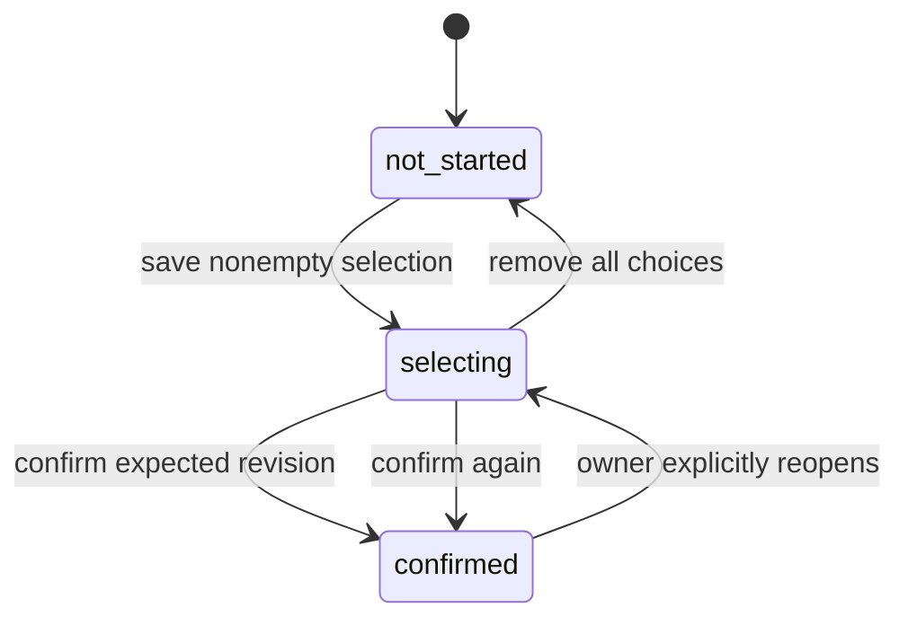

# Business rules

Status: Snappik baseline. These rules are design decisions, not assertions about Fastpik internals.

## Identity, setup and entitlements

| ID | Rule |
|---|---|
| BR-TEN-001 | Every project and its records belong to exactly one studio. Resolve studio membership server-side; never trust an arbitrary tenant header |
| BR-ONB-001 | Provision user mapping, studio, owner membership, settings and a trial grant exactly once. Setup becomes ready only with a valid vendor name/slug and all required records |
| BR-ENT-001 | Initial pilot trial is seven 24-hour days from first successful studio provisioning and permits at most three non-archived projects. Repeated login/setup never resets it |
| BR-ENT-002 | Active entitlement is evaluated at server time against nonrevoked grants. Effective project limit is the highest applicable active grant limit. Manual pilot grants require operator reason and fixed dates |
| BR-ENT-003 | Expired entitlement blocks new projects, configuration changes, resync and reopen. Owner read/export, gallery revocation, archive and privacy requests remain allowed. Existing client workflows continue until their own deadlines; do not erase selections at subscription expiry |
| BR-ENT-004 | Suspended studio blocks all client access and owner business mutations, except security logout and privacy/support requests. Owner sees restricted status/support, not operational data. Operator diagnostics remain separately authorized |

Vendor slug: lowercase ASCII letters, digits and hyphens, 3–50 characters, globally unique and not a reserved application path. Display name: 1–100 characters. Slug is branding, not an authorization key. Gallery URL is `/g/{publicToken}` and survives display-name/slug changes.

## Project and source rules

| ID | Rule |
|---|---|
| BR-PROJ-001 | Require a client label, valid Drive folder ID and at least one enabled workflow. Main quota must be an integer 1–500 when main is enabled; otherwise null. Phone fields are optional, normalized when provided |
| BR-PROJ-002 | Copy settings into a new project/workflow snapshot. Later default edits do not change existing projects. Apply explicit overrides only; never replace unchanged deadlines with forever |
| BR-PROJ-003 | Create project, workflow rows, empty selection set, audit event and inventory job in one transaction after locking studio quota. An idempotent retry returns the same project |
| BR-DRIVE-001 | Allow JPG/JPEG/PNG/WebP images up to 50 MiB each. Pilot ceilings: 5,000 images/project and traversal depth 10. Show a limit error rather than silently presenting a complete inventory |
| BR-DRIVE-002 | Identify each photo by `(project_id, provider_file_id)`, preserving original filename, MIME type, source version and folder path. Names differing only in case or extension remain distinct |
| BR-DRIVE-003 | Traverse only the authorized source subtree; do not follow shortcuts outside it in MVP. Skip trashed/unsupported entries with counts. Only a complete successful scan can mark previously seen files unavailable |
| BR-DRIVE-004 | Failed refresh keeps the last complete inventory and saved choices. Removed files become unavailable, not silently unselected. Confirmation containing unavailable files requires the client to remove/replace them; preserve older confirmation snapshots |
| BR-PROJ-004 | Archive immediately denies client access and removes the project from active quota. Restore rechecks entitlement/quota and restores original absolute deadlines, not fresh durations |

Source access method is gated by DEC-002. Do not promise access to every public/shared Drive type until the technical spike validates it. Main/download are the only persisted workflow kinds in MVP; introduce extras/print through explicit migrations later.

## Access and time

| ID | Rule |
|---|---|
| BR-ACCESS-001 | A high-entropy public token identifies a shared project. Optional main/download passwords are independent. A server-side menu grant must pass current project/studio state, menu enablement, access version and deadline on every protected request |
| BR-ACCESS-002 | `expires_at = null` means no project deadline. Otherwise deny at `server_now >= expires_at`. Store UTC instants; duration input means N×24 hours from save. Display localized absolute date and remaining time |
| BR-ACCESS-003 | Rotate/revoke share access or change a password by incrementing access version and invalidating issued gallery grants. Disable a menu immediately. Previously downloaded files and externally shared Drive links cannot be revoked by Snappik |
| BR-ACCESS-004 | Grant expiry is the earlier of 12 hours and workflow expiry. Each menu requires its own authorization. The public landing response exposes only limited label/branding/menu availability, never photos, source folder IDs, owner contacts or notes |

Password input: 8–128 characters; store only an approved slow password hash. Gallery passwords are separate from account authentication. Account credentials remain with the chosen auth provider.

## Selection state machine

One collaborative main selection set belongs to each project. All authorized clients with its link operate on that same set; this is intentionally not one private set per visitor. Show this in client help.

| ID | Rule |
|---|---|
| BR-SEL-001 | Selection count is 0…quota; confirmation requires at least 1 photo, not the full quota. Display quota as a maximum, not a compulsory count |
| BR-SEL-002 | Each selected photo must belong to this project and be available. Notes belong to selected photos only, are plain text, and have a maximum of 500 Unicode code points. Removing a photo removes its current draft note |
| BR-SEL-003 | Every draft save, note change, confirmation or reopen uses an expected revision and atomically increments it. Lock project then selection set, then validate. Reject stale revisions with 409 and current revision; never silently overwrite |
| BR-CONF-001 | Confirm validates current revision, access and every item, writes an immutable file/filename/path/note snapshot, records server timestamp and locks future client changes in the same transaction |
| BR-CONF-002 | Reopen is an authenticated owner action with a reason, requiring active entitlement. It retains items and prior snapshots, clears current confirmation status, increments revision and notifies/polls clients to refresh. Client grants alone cannot reopen |
| BR-CONF-003 | Repeat confirmation with the same idempotency key returns the original result. A different key against an already confirmed set fails `SELECTION_LOCKED`; it does not add another snapshot |
| BR-CONF-004 | Config edits lock project then selection set, using that same lock order as selection operations. Reject quota reductions below draft count and reject quota/source-root changes while confirmed. Reopen first; replacing a source root with existing choices is unsupported in MVP—create another project |

Main confirmation, download permission, inventory health and entitlement are separate dimensions. Do not infer any of them from a single project status. Owner result screens show both last confirmed snapshot and current draft status after reopen; export must identify which revision it represents.

## Results, reliability and retention

| ID | Rule |
|---|---|
| BR-RESULTS-001 | CSV export includes stable photo reference, provider file ID, original filename, folder path, note and confirmation revision. Human-readable copy includes folder context. Do not strip extensions/case in authoritative exports |
| BR-DL-001 | Individual download requires download-menu grant and an available project photo, independent of main selection membership. Proxy/fetch via a controlled provider adapter; never accept an arbitrary fetch URL from a client |
| BR-TRACK-001 | Dashboard counts derive from canonical state. Default polling is every 15 seconds while visible, with backoff when hidden/errors occur, manual refresh and last-updated indicator. Do not label it realtime push |
| BR-REL-001 | Idempotency scope is actor/session, studio/project, operation and key. Retain records 24 hours; a key reused for a different body fails 409. Business uniqueness and transaction constraints still hold after key expiry |
| BR-REL-002 | Retry transient provider/job failures with bounded backoff. Lease jobs and recover abandoned work. Replays may redo technical processing but must not duplicate project or confirmation records |
| BR-RET-001 | Archived projects can be restored for 30 days. At expiry, purge client records/derived assets after a queued recheck. Purge never deletes originals from Drive. Draft retention/legal requirements require DEC-006 before public launch |
| BR-RET-002 | Proposed operational retention: derived thumbnail cache 7 days idle; gallery sessions expire within 12 hours; request logs 14 days; audit events 180 days; backups 30 days. These are baseline engineering limits subject to DEC-006, not legal conclusions |
| BR-OPS-001 | Operator mutations require explicit permission, reason and audit record; no unlogged impersonation. Entitlement grants and suspension/reactivation are the only business mutations exposed in MVP operator UI |

Ceilings and pilot entitlement values are versioned product configuration. Changing them requires updates to UI copy, validation, tests and pricing before a commercial release.
