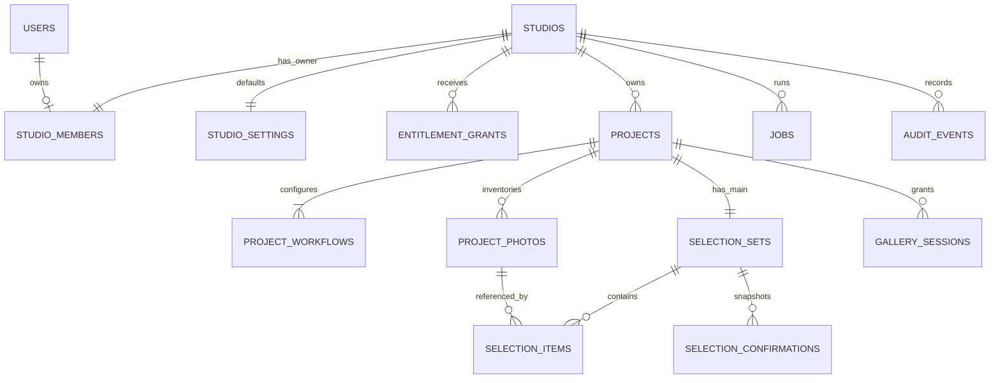

# Database design

Shared admission extension: [ADR-013](decisions/ADR-013-shared-auth-admission.md), [admission evidence](auth/DEC-001-ADMISSION-EVIDENCE-2026-10-19.md); reviewed [auth005](../src/db/auth-migrations/005_auth_admission.sql) adds admission_policy(namespace PK,fingerprint HMAC64) and admission_bucket(key_hash HMAC64 PK,scope global/subject/native,used1–10000,expires_at), expiry index and PUBLIC revocation. No prior SQL/user/recovery/business rows rewritten. Runtime readiness now requires005. Trusted runtime can SELECT/INSERT policy only, CRUD buckets; cannot change policy/DDL. Independent transactions under advisory734006 atomically check/increment using primary DB clock, commit attempted work before credential gate734004, and lazily remove<=32 expired rows. Total bucket cap10000 enforced under that lock; active rows never evicted. Expired idle hashes can remain until traffic resumes; no strict physical-deletion SLA. Namespace rows are controlled configuration, not client input. DB/timeout/capacity/policy mismatch fails closed; grants/migration were tested on isolated populated004, not deployed. New policy/key requires reviewed coordinated transition; no mixed pre005 runtime rollout/rollback. Safe diagnostics: aggregate bucket scope/count/used/expiry only; no public inspection/reset API.

Recovery handoff: [ADR-012](decisions/ADR-012-recovery-code-handoff.md) changes delivery interpretation only: encrypted v1 payload token becomes a separate code; the clean link contains no proof. SHA256 lookup,15-minute expiry, auth SQL/grants, proof fence and atomic version/revocation remain unchanged. No migration/user-data reset or queued-job deletion; pending ciphertext stays readable. [handoff evidence](auth/DEC-001-HANDOFF-EVIDENCE-2026-10-19.md) includes reconstructed delivery and cookie-less reset verification.

Status: logical MVP contract with initial provider-independent [app migrations](../src/db/migrations/001_foundation.sql) and [lease expansion](../src/db/migrations/002_lease_fencing.sql), verified on isolated PostgreSQL 18.4 in BL-003. Reviewed auth tables exist for the opt-in local slice; production auth and unresolved Drive credential/resource-key extensions remain gated. Existing source fields do not prove source validation. Apply only reviewed migrations to a known isolated database; no provider/production readiness is implied. IDs below are UUIDs unless stated otherwise; timestamps are `timestamptz` stored as UTC; JSON is `jsonb` with application schema validation. Use `NOT NULL` unless a field is explicitly optional. Audit timestamps are server-generated.

## Relationships

19 October auth implementation: [ADR-009](decisions/ADR-009-auth-local-hardening.md) and [evidence](auth/DEC-001-EVIDENCE-2026-10-19.md) add reviewed, separately journaled [auth SQL](../src/db/auth-migrations/001_better_auth.sql), [account constraint](../src/db/auth-migrations/002_account_identity.sql) and [security metadata](../src/db/auth-migrations/003_session_security.sql). App 001/002 remain unchanged. snappik_auth holds pinned library tables; public.owner_session_security references native session/app user. Migration 002 locks account writes and aborts on any duplicate pair without changing rows, merging users or advancing its journal. Unmanaged auth tables are not silently adopted. Existing sessions lacking metadata stay denied. Apply only to a reviewed known local target through `npm run db:auth:migrate`; no startup DDL/generator. [Auth grants](../src/db/auth-grants.sql) were tested as non-owner SQL probes. No deployed credentials or production provider readiness.

Current session/data guard locks app user then reads native session plus metadata/version/verification/expiry. Implemented onboarding repeats it within its transaction; logout uses that same user lock and persists revocation before library cleanup. Single-session revocation clears MFA; all-device reset/version synchronization remains pending. Tables/fields in the candidate section below are now implemented for the local slice only; its historical native-schema finding is mitigated by reviewed migration 002, not by a library patch.

## Identity and entitlement tables

| Table | Fields | Keys / rules |
|---|---|---|
| `users` | id, auth_provider, auth_subject, email_normalized, display_name, security_version, created_at, updated_at | Unique `(auth_provider, auth_subject)`; email nonunique metadata, never merge key; security_version >=1 invalidates older sessions; no password storage; candidate namespace mapping below |
| `studios` | id, name optional until setup, slug optional until setup, revision, status (`setup_required/active/suspended`), provisioned_at, created_at, updated_at | Unique nonnull slug; active requires valid name/slug; revision >= 1; suspension action audited; reactivation derives setup_required/active from setup completeness |
| `studio_members` | studio_id, user_id, role (`owner`), created_at | PK `(studio_id,user_id)`; unique studio_id and user_id for MVP; role CHECK owner; future staff requires migration |
| `studio_settings` | studio_id, locale (`id/en`), timezone, revision, defaults_schema_version, project_defaults, created_at, updated_at | PK/FK studio_id; revision >= 1 for optimistic concurrency; defaults_schema_version identifies the defaults JSON schema; one row per studio; timezone validated against supported IANA zones |
| `entitlement_grants` | id, studio_id, source (`trial/manual`), starts_at, ends_at, project_limit, revoked_at optional, source_ref, granted_by optional user ID, reason optional, created_at | end > start; limit >= 1; unique `(studio_id,source,source_ref)`; one trial grant per studio using partial unique index; manual requires actor/reason |
| `platform_roles` | user_id, permission (`diagnostics_read/entitlement_write/studio_suspend`), created_at, granted_by optional | PK `(user_id,permission)`; runtime operators cannot self-grant; bootstrap through controlled deployment process |

Provision identity mapping idempotently, then lock the user mapping and create its studio/membership/settings/trial in one transaction. Unique memberships prevent concurrent provisioning from creating two studios. Existing provider identity can have several attempts but only one successful provision. Email/Google account linking requires verified provider support; do not join on unverified email alone.

BL-004 implements this app-side transaction in [service](../src/modules/onboarding/service.ts) against unchanged 001/002 schema. Unique-key insert/reload → user row lock → membership/studio lock → missing settings/trial insert → optional first profile completion/audit → expiry recheck → commit. Provider requests happen before the transaction. Trial starts_at is selected directly from studio.provisioned_at inside PostgreSQL, ends_at is exactly +168 hours, project_limit 3, source_ref initial-trial. Avoid a JavaScript Date round-trip that truncates PostgreSQL microseconds. Existing/revoked trials and defaults are never replaced. A new studio captures clock_timestamp after obtaining the identity lock. A failed transaction rolls back mapping and every dependent row; no partial acknowledged setup. ADR-009/010 add actual guarded local credential sessions and same-transaction session revalidation; real-provider/production acceptance remains gated.

[Onboarding grants](../src/db/onboarding-grants.sql) extend the trusted service role with identity/studio/membership/settings/trial inserts and profile/settings field updates. Tested with a non-owner role; no trial update/delete, membership reassignment, operator self-grant or DDL. This is service authorization with scoped repositories, not RLS. No new provider-owned schema or production migration was created/applied.

## Projects and inventory

| Table | Fields | Keys / rules |
|---|---|---|
| `projects` | id, studio_id, public_token, access_version, client_label, client_phone optional, admin_phone optional, drive_folder_id, detect_subfolders, cover_photo_id optional, notes_enabled, layout (`grid/masonry`), revision, inventory_status (`pending/ready/failed`), inventory_generation optional, last_successful_sync_at optional, archived_at optional, created_at, updated_at | Unique public_token; cryptographic random 192-bit token; revision/access_version >= 1; unique `(studio_id,id)`; source-root replacement restricted |
| `project_workflows` | id, studio_id, project_id, kind (`main/download`), enabled, quota optional, expires_at optional, password_hash optional, access_version, created_at, updated_at | Unique `(project_id,kind)`; composite FK `(studio_id,project_id)`; main quota 1–500 if enabled; download quota null; workflow access_version >= 1 |
| `project_photos` | id, studio_id, project_id, provider_file_id, filename, folder_path, mime_type, size_bytes, source_version, available, seen_generation, derived_asset_key optional, last_seen_at, created_at, updated_at | Unique `(project_id,provider_file_id)` and `(studio_id,project_id,id)`; composite project FK; size >= 0; filename not unique |

`cover_photo_id` must reference a photo in the same studio/project using the composite key; unavailable covers fall back to a neutral project cover. Inventory retains records referenced by historical confirmations. Provider source version is an opaque provider value, not assumed globally monotonic.

Only a completed generation marks unseen photos `available=false`. Failed scans leave the last successful availability view intact. Folder path is descriptive metadata; folder identities may be stored in inventory job progress for traversal, not used as photo identity.

### DEC-002 pending credential persistence

Design only, paired with [API](API.md), [ADR-007](decisions/ADR-007-drive-source-credentials.md) and the [candidate lifecycle](drive/ADAPTER_CONTRACT.md); no table/column/migration added. Existing 001/002 source columns are insufficient for credentials/resource keys. Candidate `drive_connections` records need studio ownership, explicit mode, stable provider subject and project/client config reference, granted scopes, status, monotonic connection version, expiry/validation/revocation timestamps and encrypted refresh-secret reference/key version. Never use email as identity or add raw token columns to project/selection/job/audit payloads.

Candidate `projects.drive_connection_id` requires composite FK `(studio_id,drive_connection_id)` to the same studio; root resource key needs encrypted private storage scoped to project. Private per-file keys and root-relative folder-ID ancestry need a scoped side table/reference for traversal/media revalidation, not plaintext confirmation snapshots. Preserve current unique `(project_id,provider_file_id)` and original name/path/version. No key/credential is exported. The candidate API resource-key bound (1–200 safe ASCII characters) is application validation, not a Google length guarantee.

Disconnect transaction increments connection version, disables operational use and writes revocation/cache-cleanup work atomically; active workers must recheck/fence connection plus project config/generation before publication and before new media reads. Lock connection before project then selection set where needed; perform no provider I/O under these locks and review every reconnect/refresh/publish path. Refresh CAS/lease prevents a late response from resurrecting a disconnected connection. Jobs carry scoped connection/version references only. Revocation-only encrypted material has a bounded separate lifecycle/deletion deadline; backup restore must reapply later revocation/deletion before use. Exact schema/grants/retention/race tests await approved mode/tooling and provider evidence; no new persistence claim is made.

## Selection and gallery access

| Table | Fields | Keys / rules |
|---|---|---|
| `selection_sets` | id, studio_id, project_id, workflow_id, workflow_kind (`main`), status (`not_started/selecting/confirmed`), revision, current_confirmation_id optional, updated_at | One set per project/workflow; composite FKs to same tenant/project/workflow/kind; revision >= 0; constant discriminator enforces MVP main only |
| `selection_items` | studio_id, project_id, selection_set_id, photo_id, note optional, selected_at | PK `(selection_set_id,photo_id)`; composite FKs prevent cross-project set/photo references; note <=500 code points; notes plain text |
| `selection_confirmations` | id, studio_id, project_id, selection_set_id, confirmed_revision, actor_kind (`client/owner`), actor_reference, snapshot, confirmed_at | Unique `(selection_set_id,confirmed_revision)`; snapshot array contains photo ID, provider ID, name, path, source version, note; immutable after insert |
| `gallery_sessions` | id, token_hash, studio_id, project_id, workflow_id, project_access_version, workflow_access_version, expires_at, revoked_at optional, created_at | Unique token_hash; composite FKs; random opaque cookie token returned once, only hash persisted; never authorizes owner API |

Create composite unique keys on `project_workflows(studio_id,project_id,id)` and `selection_sets(studio_id,project_id,id)` for the corresponding foreign keys. A current-confirmation reference must belong to that set: use a composite FK to `(selection_set_id,id)` on confirmations, deferrable if needed. Updating the current pointer does not mutate old snapshots.

Draft state/count/quota and confirmation transitions involve multiple rows, so use transactional service validation while holding locks rather than a cross-row CHECK. PostgreSQL supports composite unique and foreign-key constraints; cross-row checks are not supported as ordinary CHECK invariants. See [PostgreSQL constraints](https://www.postgresql.org/docs/current/ddl-constraints.html).

## Reliability and audit tables

| Table | Fields | Keys / rules |
|---|---|---|
| `jobs` | id, studio_id optional for global maintenance, project_id optional, kind, dedupe_key, payload, state (`queued/running/succeeded/failed`), attempts, available_at, lease_until optional, worker_id optional, lease_token, result optional, error_code optional, created_at, finished_at optional | Partial unique active `(kind,dedupe_key)`; bounded versioned payload; lease_token bigint increments on claim; recovery/renew/fail/publish require current unexpired token+worker; optional project FK consistent with studio |
| `idempotency_keys` | id, scope, key, request_hash, state (`in_progress/completed`), response_status optional, response_body optional, created_at, expires_at | Unique `(scope,key)`; response contains no passwords or gallery cookie material; mutation writes/marks completion atomically |
| `audit_events` | id, studio_id optional, project_id optional, actor_kind, actor_id optional, action, target_type, target_id, reason optional, before_summary optional, after_summary optional, request_id, created_at | Append-only application access; redact secret/token/note values; separate retention from project content |

## Required indexes

- Projects: `(studio_id, archived_at, created_at DESC)`; unique public token; source inventory health by studio.
- Workflows: `(studio_id, expires_at)` for enabled rows; no clock-dependent index predicate.
- Photos: `(project_id, available, folder_path, filename, id)` and source-ID unique key.
- Selection sets: `(studio_id,status,updated_at DESC)`; item primary key; confirmations `(selection_set_id,confirmed_at DESC)`.
- Grants: `(studio_id, starts_at, ends_at)` for nonrevoked rows.
- Gallery sessions: token_hash unique, expires_at cleanup index.
- Jobs: `(state,available_at)` and lease expiry for running jobs.
- Idempotency: expires_at cleanup; audit: `(studio_id,created_at DESC)` and request_id.

## Transaction recipes

**Create:** reserve/check idempotency key → lock studio → evaluate active grant/quota → insert project, two workflow rows and selection set → enqueue inventory → write audit → complete key → commit. Archived projects do not count; restore uses the same studio lock.

**Save draft:** resolve verified grant → lock project then selection set → recheck workflow/access/expiry and expected revision → validate unique in-project available IDs and notes → replace current items → derive status → increment revision → commit. Confirmed sets reject mutation.

**Confirm:** reserve idempotency key → lock project then set → recheck access/revision/items → insert snapshot using next revision → update set state/current snapshot/revision → append event → complete key → commit. Response loss cannot create a second snapshot.

**Reopen:** authenticate owner/entitlement → lock project then set → compare revision, require confirmed → retain items/snapshots, clear current pointer, set selecting, increment revision → append reasoned event → commit.

**Inventory completion:** lock project then set before publishing availability changes so confirmation cannot race publication. External scanning happens outside locks. Removed selected references remain for review/history.

## Deletion and migration policy

BL-003 adds `schema_migrations(name,checksum,applied_at)` and singleton `schema_compatibility(minimum_runtime)`. SQL+journal commit atomically under an advisory lock. Runtime level 2 requires migration 002 and minimum_runtime <=2. Future compatible expansions retain that floor; breaking contracts raise it after planning deployment. SQL tests cover empty DB, 001 populated data -> 002, repeated/concurrent apply, drift rejection, failed-DDL rollback, additive future read and incompatible-floor denial. No destructive down/reset command exists. Roll back applications to a compatible level-2 artifact while retaining schema; never resume a pre-fencing worker. No old production artifact or hosted rollback/restore is verified.

[Runtime grants](../src/db/runtime-grants.sql) are a separate non-owner role template, tested with SET ROLE in the isolated cluster. They grant queue/key writes, allowlisted audit insertion and limited counter/role columns for SELECT FOR UPDATE; no membership-key/operator/history/DDL writes. Later business services need their own least-privilege write grants. Repositories implement tenant predicates; composite FKs protect relational scope, without claiming RLS. Trigger-protected audit deletion needs a separately reviewed retention mechanism in BL-015; no general bypass/purge helper is exposed now.

Archive is reversible. Purge checks archived timestamp, restore status and any retention hold inside a transaction before deleting project-owned data and queuing object deletion. Keep minimal redacted audit evidence only for the approved retention window. Never cascade into users/studios or upstream Drive files from project purge.

Migrations are reviewed, forward-numbered and tested on production-like synthetic data. Add new columns nullable/backfill/validate before tightening constraints. Do not use destructive schema rollback as an ordinary release rollback. Future extra/print modes add workflow-specific tables and immutable base-confirmation references; do not overload filename arrays or arbitrary JSON for relational identities.

## BL-001 candidate auth persistence boundary

19 October recovery extension: [ADR-010](decisions/ADR-010-password-recovery-outbox.md), [evidence](auth/DEC-001-RECOVERY-EVIDENCE-2026-10-19.md), reviewed [auth004](../src/db/auth-migrations/004_password_recovery.sql). Earlier dated unimplemented statements below are historical; current local mapping/session guard and recovery tables exist. Runtime requires004 before auth initialization. App001/002 and auth001–003 unchanged; populated003 upgrade/reapply preserves credentials/sessions/business records. No production database was changed.

| Local auth table | Fields/invariants |
|---|---|
| `recovery_requests` | HMAC request_hash PK/address_hash,created_at; no raw address/token/password; address+UUID dedupe and per-address budget; ineligible accounts have same receipt path |
| `password_recovery` | SHA256 token_hash PK,user_id nullable FK native user,expires_at,consumed_at,created_at; null user for indistinguishable ineligible request;15-minute expiry; one committed consumption; no plaintext token |
| `recovery_outbox` | UUIDid,unique token_hash FK,payload versioned AEAD or null,state,attempts0–3,available_at,lease_id/until,error_code,delivery_mode,created/finished; queued/running require ciphertext; running requires lease pair; terminal states erase payload; delivery_mode only synthetic |

Request receipt/token/encrypted job writes commit together for known/unknown users. Same-address receipt lock protects3/hour budget; HTTP credential gate also serializes issuance with reset. Reset takes credential advisory lock then mapped app-user lock, consumes only unexpired/unused token, delegates hashing to native library, updates its credential account, increments users.security_version/revokes owner_session_security and clears assurance, consumes all user tokens/cancels outbox, removes pending2fa/trust proof. One transaction; no session auto-creation, factor/role/studio/trial mutation. Native cleanup is not necessary for app denial. Raw library calls must never bypass the wrapper. Current local gate serializes credential operations database-wide; session validation uses the user lock, pool minimum2. This is not a tested multi-tenant throughput design.

Outbox claim uses SKIP LOCKED and current random lease fencing,30s lease,5s adapter timeout,max3 claims,30s then120s retry. Restart recovers expired claims; a crashed third attempt becomes failed on next drain. Delivery is at-least-once; stable outbox ID supports adapter dedupe. Consume/expiry cancels payload; encrypted data is never a public result. Explicit synthetic CLI drains<=10, reports aggregate state/error/oldest age and deletes recovery-only rows1day after expiry (receipts1day old). No automatic scheduler/real delivery exists. Auth grants extend only the trusted service role; non-owner enqueue/reset probes passed, not deployed IAM. Eventual retention/rotation/restore/distributed abuse and sender contracts remain gates.

The mapping/security/reset requirements are implemented for the 19 October local slice; production and real delivery remain conditional. DEC-001 remains open; see historical [ADR-004](decisions/ADR-004-auth-session-feasibility.md), current follow-up and [session contract](auth/SESSION_CONTRACT.md).

18 October follow-up: [ADR-006](decisions/ADR-006-auth-session-postgres-validation.md) and [evidence](auth/DEC-001-EVIDENCE-2026-10-18.md) now exercise native library tables in a fresh isolated PG cluster; app security metadata below remains logical/unimplemented. Generated Better Auth 1.7.9 schema accepted duplicate `(providerId,accountId)`; reviewed auth migrations must enforce this pair, binding each providerId to one fixed issuer and handling conflicts without repointing accounts. A spike-only unique index rejected duplicates; production namespace/grants/callback-link races remain unverified. Session tokens were unique. No app migration changed.

For Better Auth candidate, auth_provider is `better-auth:<AUTH_INSTANCE_ID>` and auth_subject is the immutable library user UUID, not email or upstream OAuth account ID. Library account records connect several credentials to that user. Upstream linking must preserve that library user; it never merges app studios. Namespace changes require reviewed migration.

Library-owned user/session/account/verification/twoFactor tables must be mapped to a separately restricted auth namespace without colliding with app users. Their exact fields/indexes come from the pinned library schema and reviewed adapter migrations. UUID generation is configured. Account password hashes, encrypted factor material, verification secrets and any retained provider tokens stay in that credential boundary, never app users or business DTOs. Raw library session tokens may be credential-bearing DB data; do not assume they are hashed because gallery token_hash is. Restrict database/backup access and review encryption. No live-provider or production account tables have been provisioned; reviewed local tables exist.

| Local table | Fields | Required constraints / semantics |
|---|---|---|
| `owner_session_security` | session_id, user_id, security_version, revoked_at optional, mfa_verified_at optional, mfa_method optional, created_at | PK/FK session_id to library session UUID, FK user_id to app users; bind same mapped subject server-side; version >=1; method/time both null or both present; method totp/backup_code; only fresh totp authorizes operator; cascade metadata on actual session deletion |

Create metadata transactionally before business authorization, never restore a revoked row on retry. Session lookup requires row/version validity and denies at server_now >= expires_at. Missing metadata fails closed. Logout/all-device reset serialize on app user and persist revocation/version before acknowledging; library cleanup failure cannot undo durable denial. Recheck under that user lock before sensitive writes, followed by studio/project/set order. Factor recovery clears assurance and invalidates sessions. Never use a replica-stale read or in-memory tombstone to assert immediate revocation.

Verify unique external account keys, mapping upsert, callback/link/reset consumption, metadata creation, logout race, cross-instance/restart denial and rollback on real PostgreSQL with separate connections. The memory adapter's tests establish no SQL constraint, transaction or race claim.
