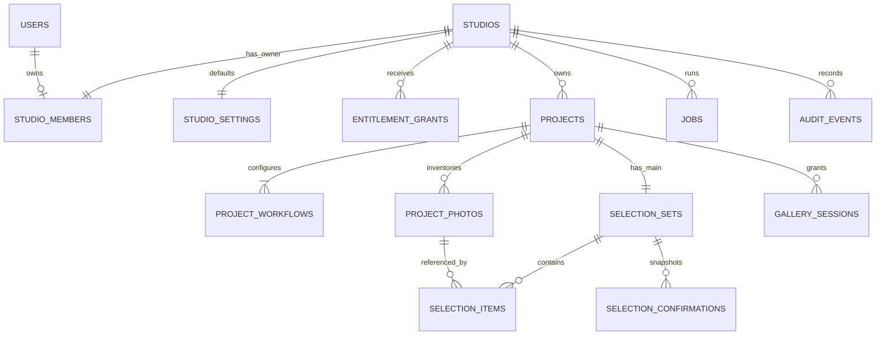

# Database design

Status: logical PostgreSQL schema for MVP, not executable migration SQL. Apply migrations only after provider/identity decisions and schema review. IDs below are UUIDs unless stated otherwise; timestamps are `timestamptz` stored as UTC; JSON is `jsonb` with application schema validation. Use `NOT NULL` unless a field is explicitly optional. Audit timestamps are server-generated.

## Relationships

## Identity and entitlement tables

| Table | Fields | Keys / rules |
|---|---|---|
| `users` | id, auth_provider, auth_subject, email_normalized, display_name, security_version, created_at, updated_at | Unique `(auth_provider, auth_subject)`; email nonunique metadata, never merge key; security_version >=1 invalidates older sessions; no password storage; candidate namespace mapping below |
| `studios` | id, name optional until setup, slug optional until setup, revision, status (`setup_required/active/suspended`), provisioned_at, created_at, updated_at | Unique nonnull slug; active requires valid name/slug; revision >= 1; suspension action audited; reactivation derives setup_required/active from setup completeness |
| `studio_members` | studio_id, user_id, role (`owner`), created_at | PK `(studio_id,user_id)`; unique studio_id and user_id for MVP; role CHECK owner; future staff requires migration |
| `studio_settings` | studio_id, locale (`id/en`), timezone, revision, defaults_schema_version, project_defaults, created_at, updated_at | PK/FK studio_id; revision >= 1 for optimistic concurrency; defaults_schema_version identifies the defaults JSON schema; one row per studio; timezone validated against supported IANA zones |
| `entitlement_grants` | id, studio_id, source (`trial/manual`), starts_at, ends_at, project_limit, revoked_at optional, source_ref, granted_by optional user ID, reason optional, created_at | end > start; limit >= 1; unique `(studio_id,source,source_ref)`; one trial grant per studio using partial unique index; manual requires actor/reason |
| `platform_roles` | user_id, permission (`diagnostics_read/entitlement_write/studio_suspend`), created_at, granted_by optional | PK `(user_id,permission)`; runtime operators cannot self-grant; bootstrap through controlled deployment process |

Provision identity mapping idempotently, then lock the user mapping and create its studio/membership/settings/trial in one transaction. Unique memberships prevent concurrent provisioning from creating two studios. Existing provider identity can have several attempts but only one successful provision. Email/Google account linking requires verified provider support; do not join on unverified email alone.

## Projects and inventory

| Table | Fields | Keys / rules |
|---|---|---|
| `projects` | id, studio_id, public_token, access_version, client_label, client_phone optional, admin_phone optional, drive_folder_id, detect_subfolders, cover_photo_id optional, notes_enabled, layout (`grid/masonry`), revision, inventory_status (`pending/ready/failed`), inventory_generation optional, last_successful_sync_at optional, archived_at optional, created_at, updated_at | Unique public_token; cryptographic random 192-bit token; revision/access_version >= 1; unique `(studio_id,id)`; source-root replacement restricted |
| `project_workflows` | id, studio_id, project_id, kind (`main/download`), enabled, quota optional, expires_at optional, password_hash optional, access_version, created_at, updated_at | Unique `(project_id,kind)`; composite FK `(studio_id,project_id)`; main quota 1–500 if enabled; download quota null; workflow access_version >= 1 |
| `project_photos` | id, studio_id, project_id, provider_file_id, filename, folder_path, mime_type, size_bytes, source_version, available, seen_generation, derived_asset_key optional, last_seen_at, created_at, updated_at | Unique `(project_id,provider_file_id)` and `(studio_id,project_id,id)`; composite project FK; size >= 0; filename not unique |

`cover_photo_id` must reference a photo in the same studio/project using the composite key; unavailable covers fall back to a neutral project cover. Inventory retains records referenced by historical confirmations. Provider source version is an opaque provider value, not assumed globally monotonic.

Only a completed generation marks unseen photos `available=false`. Failed scans leave the last successful availability view intact. Folder path is descriptive metadata; folder identities may be stored in inventory job progress for traversal, not used as photo identity.

## Selection and gallery access

| Table | Fields | Keys / rules |
|---|---|---|
| `selection_sets` | id, studio_id, project_id, workflow_id, status (`not_started/selecting/confirmed`), revision, current_confirmation_id optional, updated_at | One set per project/workflow; composite FKs to same tenant/project/workflow; revision >= 0; MVP main only |
| `selection_items` | studio_id, project_id, selection_set_id, photo_id, note optional, selected_at | PK `(selection_set_id,photo_id)`; composite FKs prevent cross-project set/photo references; note <=500 code points; notes plain text |
| `selection_confirmations` | id, studio_id, project_id, selection_set_id, confirmed_revision, actor_kind (`client/owner`), actor_reference, snapshot, confirmed_at | Unique `(selection_set_id,confirmed_revision)`; snapshot array contains photo ID, provider ID, name, path, source version, note; immutable after insert |
| `gallery_sessions` | id, token_hash, studio_id, project_id, workflow_id, project_access_version, workflow_access_version, expires_at, revoked_at optional, created_at | Unique token_hash; composite FKs; random opaque cookie token returned once, only hash persisted; never authorizes owner API |

Create composite unique keys on `project_workflows(studio_id,project_id,id)` and `selection_sets(studio_id,project_id,id)` for the corresponding foreign keys. A current-confirmation reference must belong to that set: use a composite FK to `(selection_set_id,id)` on confirmations, deferrable if needed. Updating the current pointer does not mutate old snapshots.

Draft state/count/quota and confirmation transitions involve multiple rows, so use transactional service validation while holding locks rather than a cross-row CHECK. PostgreSQL supports composite unique and foreign-key constraints; cross-row checks are not supported as ordinary CHECK invariants. See [PostgreSQL constraints](https://www.postgresql.org/docs/current/ddl-constraints.html).

## Reliability and audit tables

| Table | Fields | Keys / rules |
|---|---|---|
| `jobs` | id, studio_id optional for global maintenance, project_id optional, kind, dedupe_key, payload, state (`queued/running/succeeded/failed`), attempts, available_at, lease_until optional, worker_id optional, result optional, error_code optional, created_at, finished_at optional | Partial unique active `(kind,dedupe_key)`; bounded versioned payload; lease recovery; optional project FK consistent with studio |
| `idempotency_keys` | id, scope, key, request_hash, state (`in_progress/completed`), response_status optional, response_body optional, created_at, expires_at | Unique `(scope,key)`; response contains no passwords or gallery cookie material; mutation writes/marks completion atomically |
| `audit_events` | id, studio_id optional, project_id optional, actor_kind, actor_id optional, action, target_type, target_id, reason optional, before_summary optional, after_summary optional, request_id, created_at | Append-only application access; redact secret/token/note values; separate retention from project content |

## Required indexes

- Projects: `(studio_id, archived_at, created_at DESC)`; unique public token; source inventory health by studio.
- Workflows: `(studio_id, expires_at)` for enabled rows; no clock-dependent index predicate.
- Photos: `(project_id, available, folder_path, filename, id)` and source-ID unique key.
- Selection sets: `(studio_id,status,updated_at DESC)`; item primary key; confirmations `(selection_set_id,confirmed_at DESC)`.
- Grants: `(studio_id, starts_at, ends_at)` for nonrevoked rows.
- Gallery sessions: token_hash unique, expires_at cleanup index.
- Jobs: `(state,available_at)` and lease expiry for running jobs.
- Idempotency: expires_at cleanup; audit: `(studio_id,created_at DESC)` and request_id.

## Transaction recipes

**Create:** reserve/check idempotency key → lock studio → evaluate active grant/quota → insert project, two workflow rows and selection set → enqueue inventory → write audit → complete key → commit. Archived projects do not count; restore uses the same studio lock.

**Save draft:** resolve verified grant → lock project then selection set → recheck workflow/access/expiry and expected revision → validate unique in-project available IDs and notes → replace current items → derive status → increment revision → commit. Confirmed sets reject mutation.

**Confirm:** reserve idempotency key → lock project then set → recheck access/revision/items → insert snapshot using next revision → update set state/current snapshot/revision → append event → complete key → commit. Response loss cannot create a second snapshot.

**Reopen:** authenticate owner/entitlement → lock project then set → compare revision, require confirmed → retain items/snapshots, clear current pointer, set selecting, increment revision → append reasoned event → commit.

**Inventory completion:** lock project then set before publishing availability changes so confirmation cannot race publication. External scanning happens outside locks. Removed selected references remain for review/history.

## Deletion and migration policy

Archive is reversible. Purge checks archived timestamp, restore status and any retention hold inside a transaction before deleting project-owned data and queuing object deletion. Keep minimal redacted audit evidence only for the approved retention window. Never cascade into users/studios or upstream Drive files from project purge.

Migrations are reviewed, forward-numbered and tested on production-like synthetic data. Add new columns nullable/backfill/validate before tightening constraints. Do not use destructive schema rollback as an ordinary release rollback. Future extra/print modes add workflow-specific tables and immutable base-confirmation references; do not overload filename arrays or arbitrary JSON for relational identities.

## BL-001 candidate auth persistence boundary

Logical requirements only, not migrations or PostgreSQL evidence. DEC-001 remains open; see [ADR-004](decisions/ADR-004-auth-session-feasibility.md) and [session contract](auth/SESSION_CONTRACT.md).

For Better Auth candidate, auth_provider is `better-auth:<AUTH_INSTANCE_ID>` and auth_subject is the immutable library user UUID, not email or upstream OAuth account ID. Library account records connect several credentials to that user. Upstream linking must preserve that library user; it never merges app studios. Namespace changes require reviewed migration.

Library-owned user/session/account/verification/twoFactor tables must be mapped to a separately restricted auth namespace without colliding with app users. Their exact fields/indexes come from the pinned library schema and reviewed adapter migrations. UUID generation is configured. Account password hashes, encrypted factor material, verification secrets and any retained provider tokens stay in that credential boundary, never app users or business DTOs. Raw library session tokens may be credential-bearing DB data; do not assume they are hashed because gallery token_hash is. Restrict database/backup access and review encryption. No live account tables exist yet.

| Proposed table | Fields | Required constraints / semantics |
|---|---|---|
| `owner_session_security` | session_id, user_id, security_version, revoked_at optional, mfa_verified_at optional, mfa_method optional, created_at | PK/FK session_id to library session UUID, FK user_id to app users; bind same mapped subject server-side; version >=1; method/time both null or both present; method totp/backup_code; only fresh totp authorizes operator; cascade metadata on actual session deletion |

Create metadata transactionally before business authorization, never restore a revoked row on retry. Session lookup requires row/version validity and denies at server_now >= expires_at. Missing metadata fails closed. Logout/all-device reset serialize on app user and persist revocation/version before acknowledging; library cleanup failure cannot undo durable denial. Recheck under that user lock before sensitive writes, followed by studio/project/set order. Factor recovery clears assurance and invalidates sessions. Never use a replica-stale read or in-memory tombstone to assert immediate revocation.

Verify unique external account keys, mapping upsert, callback/link/reset consumption, metadata creation, logout race, cross-instance/restart denial and rollback on real PostgreSQL with separate connections. The memory adapter's tests establish no SQL constraint, transaction or race claim.
