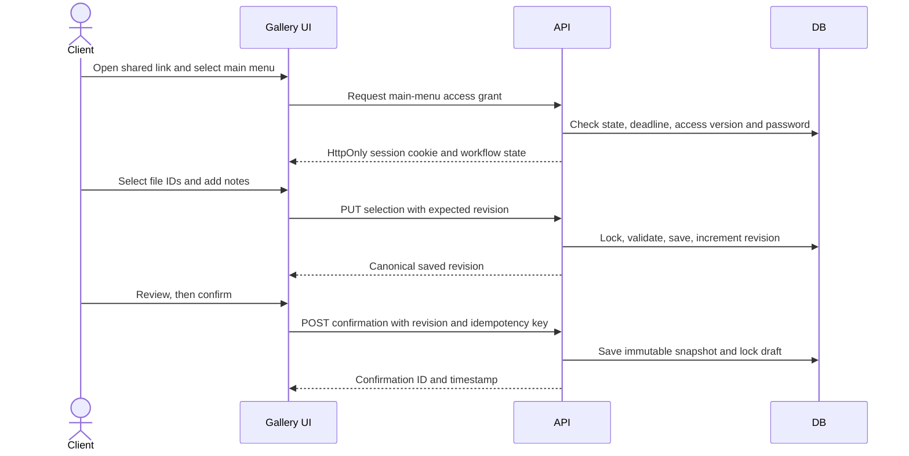

# User flows

Read [Business rules](BUSINESS_RULES.md) for exact validation. Paths below are Snappik design paths, not routes discovered on Fastpik.

## Local design walkthrough

[BL-005 prototype](../prototypes/bl005-ux/README.md) supplies scoped owner create → durable detail/inventory-pending → client neutral access gate → folder gallery/viewer → note/review → confirmation, plus explicit failure/recovery/access states. Its hash navigation and dashed lab are reviewer tools, not product routing or server enforcement. Use response presets for pending/offline/conflict/unknown/expiry and inventory presets for empty/failed/unavailable-source states. [Specification](design/BL-005-UX.md) maps reusable controls and [evidence](design/BL-005-EVIDENCE.md) records what was actually reviewed. All fixtures are synthetic; downloads/reopen/archive/export/auth/operator flows remain separate implementation work.

## Owner: first usable project

1. Visitor opens `/`, reads the product/help and selects Sign up.
2. Approved auth provider establishes identity; callback validates its return destination against an internal allowlist.
3. Server idempotently provisions studio, membership, settings and trial. `/onboarding` collects studio display name/slug.
4. If provisioning fails, show a retryable setup error; never enter an apparently usable dashboard with missing settings.
5. Owner opens `/app/projects/new`, supplies client label and Drive source, chooses subfolder detection, maximum selections and independent menu access settings. Contacts are optional.
6. Server validates and atomically saves the project, then returns its stable detail link. Source indexing runs as a job with progress/error state.
7. Detail page displays inventory readiness and share action. The owner previews the gallery before distributing it. No outgoing message is sent automatically.

Failure recovery: after a lost create response, retry the same idempotency key or navigate to recent projects. Drive failures retain the project with actionable sync status; do not silently retry creation.

## Client: select and confirm

The UI may show pending choices immediately, but must not call them saved before acknowledgement. Review/confirm waits for pending saves. Refresh restores the server state. A failed save offers Retry and retains the local pending edit visibly; it must not imply success.

On conflict, show that another tab/session changed the shared selection, reload canonical state and offer deliberate reapplication of the client's pending change. Do not merge automatically across a confirmation boundary. When deadline passes, show expiry and stop mutation even if the page was opened earlier.

Unavailable source files remain visibly identified in existing drafts. Clients can remove/replace them; confirmation is blocked until all selected references are valid. Confirmed historical snapshots remain viewable to the owner.

## Owner: process results and reopen

1. Dashboard shows selection status; owner opens `/app/projects/:id` or `/app/status`.
2. Result includes exact names, folders, notes, selected IDs and confirmation time/revision.
3. Owner copies a readable list or downloads CSV, identifying draft versus confirmed output.
4. If changes are needed, owner selects Reopen, supplies a reason and confirms the consequence in the app.
5. Server preserves current items and prior confirmation, transitions to selecting and increments revision.
6. Client refresh/poll detects new revision and permits editing. Confirmation creates a new immutable snapshot.

Main results are never implicitly emailed or sent to a dummy/contact number. Source files are not edited by confirmation or reopen.

## Client: individual download

Open gallery → select Download → satisfy its own password/expiry → browse authorized folder/photo → choose Download → server rechecks access and resolves provider ID → deliver file → show completed/failed status. Main quota and confirmation do not restrict download membership. Bulk ZIP is deferred; no button should promise it in MVP.

A revoked/expired grant fails even if a thumbnail is already on screen. Previously downloaded files cannot be recalled. Do not expose the Drive source URL as the standard download path.

## Owner: archive and entitlement expiry

Archive explains that the gallery will stop working and the project is restorable for 30 days. Server sets `archived_at`, invalidates grants and queues retention work. Restore checks entitlement/quota and keeps original dates. Only the retention worker purges expired archives.

At entitlement expiry the dashboard becomes read/export focused; explain blocked write actions and support/manual pilot renewal. Existing client workflows retain their own deadlines. Suspension is stricter and denies operational access as described in BR-ENT-004.

## Operator: onboarding repair or access grant

1. Operator authenticates through the approved provider and passes independent platform permission checks.
2. `/ops/studios` locates a studio by authorized support reference. Do not expose its galleries by default.
3. `/ops/studios/:id` displays setup completeness, entitlement dates, counts and sanitized sync/job errors.
4. Entitlement grant or suspend/reactivate requires a reason and bounded input. Server checks permission again, writes the mutation plus audit event transactionally and returns the resulting state.
5. UI shows the saved outcome and audit reference. Failed actions remain visible; no success toast on failed persistence.

Automated provisioning repair must be implemented as an idempotent internal service invoked on authorized setup retry. General-purpose database editors and operator impersonation are excluded.

## Exceptional states

| Condition | User experience | Recovery |
|---|---|---|
| Missing setup | Explicit incomplete-setup page | Resume/retry setup |
| Invalid/inaccessible Drive source | Project retained, source error and retry action | Fix permission/source, then resync |
| Capacity exceeded | Clear count/limit; gallery not reported fully ready | Reduce source size or adjust approved limit |
| Wrong gallery password | Generic error, throttled retries | Re-enter or contact studio |
| Unknown/revoked gallery | Generic unavailable page | Obtain current link from owner |
| Stale revision | Preserve pending change as unsaved; show conflict | Reload and reapply explicitly |
| Confirmation response lost | Pending status with retry using original key | Retrieve same confirmation |
| Session expires | Reauthenticate owner; keep safe unsent form in memory | Resume with server revalidation |
| Worker/provider outage | Last complete inventory remains; sync failure shown | Bounded retry/manual authorized retry |

Deferred flows for extras, print, staff, payments and custom domains must receive their own rules/API/schema review before implementation; the research diagrams are not their final contracts.
