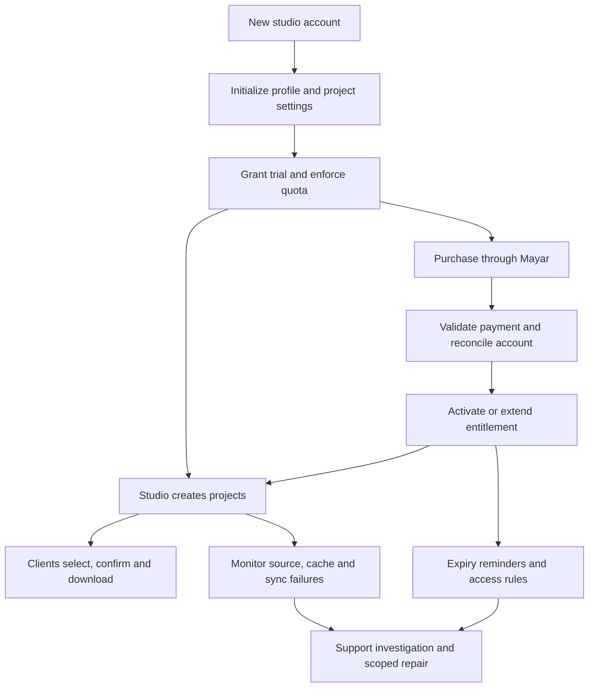

# Fastpik: live project audit and likely platform-admin logic

Date: 12 October 2026 (Asia/Makassar). This supplements and updates the [initial website audit](fastpik-audit-2026-10-12.md).

## What was created

- Project: **Fastpik Audit** — `zTFMuj9JQNDV`.
- [Client gallery](https://fastpik.id/id/client/jablay/zTFMuj9JQNDV).
- [Studio project detail](https://fastpik.id/id/projects/zTFMuj9JQNDV) — requires the supplied account login.
- Source: the Google Drive folder supplied by the user, containing **Edited: 83 photos** and **Original: 533 photos**. Fastpik reported **616 photos in two folders**.
- Vendor name: **Jablay**, derived from the account profile and saved as the required setup prerequisite.
- Both WhatsApp fields contain the user-authorized dummy number **+62 80000000000**. No messages were sent; the number is test data, not a verified recipient.
- Main selection: quota **3**, confirmed with `WII05722.jpg`, `WII05726.jpg`, and `WII05728.jpg` from Edited.
- Note on the first photo: “Audit test only — no editing requested.”
- Extra selection: quota **1**, confirmed with `WII05745.jpg`; the three initial filenames were entered as locked previous choices.
- Selection and download expiry: **19 October 2026 at 01:07**, as displayed by the site. Extra-photo expiry: **19 October 2026 at 05:57**. Each was configured for seven days at the time it was enabled.
- Subfolder detection, photo notes, cover and Grid layout enabled. Printing disabled. No gallery passwords configured. Reselection permission was tested, then disabled again.

The project and test selections remain in the account for inspection. Original Drive files were not edited, moved or deleted.

## Verified workflow and findings

| Step | Action and result | Evidence strength |
|---|---|---|
| Account initialization | Saved the required vendor name through Settings. The previously disabled single-project form became usable | Observed; backend root cause unknown |
| Required contacts | Creation rejected blank client and admin WhatsApp fields and linked the errors to the fields | Observed form validation |
| Drive ingestion | The cover picker loaded a real image; project detail counted 616 photos / two folders; gallery showed 83 and 533 in the correct folders | Observed metadata and sample rendering; not all 616 images inspected |
| Project creation | Project appeared in the list with its generated vendor/project link and seven-day expiry | Persisted record observed |
| Client menus | Main selection and download appeared initially; enabling extras added the extra-selection menu | Observed |
| Main quota | Selected three images in the viewer; the fourth image's selection button became disabled at 3/3 | UI enforcement verified; direct API/server boundary not tested |
| Photo viewer | File position, thumbnail strip, 1:1/zoom controls, selection button and keyboard hints were visible | Viewer and selection used; all gestures not tested |
| Notes | Editor displayed a 500-character maximum. Saved test note appeared beside the correct filename in admin detail | Cross-view persistence verified; 500-character boundary not stress-tested |
| Review | Review showed the correct three selected files and controls to edit, copy and confirm | Observed |
| Confirmation | Explicit confirmation displayed success and locked the three choices. Admin list/detail showed Confirmed with timestamps | Persisted status verified |
| WhatsApp handoff | Success page offered a separate WhatsApp confirmation button after saving choices | Control observed; no message sent |
| Reselection | Admin enabled reselection; after client refresh, a Reselect button appeared; all three choices remained | Observed; live permission refresh was not immediate in the already-open page |
| Relock | Reconfirmed, then disabled reselection. Admin showed reselection inactive | Observed final admin state |
| Individual download | Used the first image's download action; browser returned a saved file and UI showed download success | Successful for one JPEG |
| Bulk download model | Download help says Download All opens the Drive folder; selected photos have a separate ZIP action | UI/documentation observed; bulk ZIP not executed |
| Extra selection | Configured quota 1, locked prior filenames and separate seven-day duration; client displayed 0/1 plus three locked photos | Observed |
| Prior-choice lock | Previous photo's viewer button was disabled and labeled already selected | UI enforcement verified |
| Extra confirmation | Selected one new photo, reviewed and confirmed; admin showed main 3, previous 3, extra 1 with separate confirmation timestamps | Persisted result verified |

### 1. Onboarding failure has a practical workaround

The first audit found `Project settings not found`; repeated reload attempts did not help. Saving General settings with the vendor name initialized enough configuration for project creation to succeed. Therefore, the original conclusion should be narrowed to an **onboarding/initialization problem**, not a permanently broken creation feature.

Likely sequence: authentication/profile exists → required project-settings record or usable defaults are missing → creation refuses to proceed → saving Settings creates or completes configuration. The last step is observed; the actual insert/upsert mechanism is inferred.

Recommended fix: expose “Complete studio setup” at first login, initialize required settings idempotently, and distinguish incomplete setup from a failed network request. Creation should explain exactly what the user needs to do.

### 2. Locked filename matching is ambiguous across folders

Three `.jpg` filenames were entered into the extra-photo form's locked-previous-files field. The extra gallery header reported **three locked photos**, but its review displayed **six previous photos**, including `.jpg` and `.JPG` variants of the same three stems. Admin detail still displayed three previous names.

This is a confirmed cross-view count/mapping inconsistency for this test case. It suggests that resolving manually supplied filenames across Edited and Original can match more than one file, potentially ignoring extension case or reducing identifiers to stems. The matching algorithm itself was not inspected.

Business impact: a studio can intend to lock three exact edited files but clients see additional original counterparts as previous selections. This can confuse review, editing handoff and counts. It is not evidence that the main selection chose the wrong three Drive file IDs.

Recommended fix: carry stable Drive file IDs plus folder context into locked choices. When accepting pasted filenames, detect multiple matches and require explicit disambiguation; use consistent counts in header, review and admin results. Preserve compatibility with older filename-only records without silently selecting every match.

### 3. Creation can succeed even when the success screen is lost

After creating the project, the form reset instead of showing a clear success/link result. Console output reported an RSC payload fetch failure followed by a full browser-navigation fallback. Checking the project list showed that the project had in fact been created. No duplicate submission was made.

The cause may be connection/browser/runtime-specific. Nonetheless, this illustrates a failure mode to handle: **successful write + failed navigation** must not encourage duplicate creation. Persist a clear result, provide a recovery link to the created record, and make create requests idempotent.

### 4. The link gates and source permissions are separate

The gallery provides its own expiry, password and workflow controls, but source files remain in Google Drive. The download guide explicitly describes Download All as opening the Drive folder. Product messaging should distinguish protection of the Fastpik workflow from protection of already-shared source files. No source permission changes or access-control bypass tests were performed.

### 5. Additional technical evidence

Rendered photo elements included Google-hosted `lh3.googleusercontent.com` URLs and a `thumb.ryanekoapp.web.id/t` thumbnail endpoint with file ID, size and version parameters. This establishes two visible image-delivery paths, not their internal storage, retention or fallback implementation.

The observed `Failed to fetch RSC payload` console message further supports the Next.js/React Server Components architecture assessment. It does not establish exact framework versions.

## Admin means two different roles

**Studio admin** is the role actually exercised: account settings, project creation, quotas, Drive source, client-link distribution, review, confirmation, reopening and subscription management.

**Platform admin/operator** means the people operating Fastpik itself: customer accounts, entitlements, payments, custom domains, integrations, reliability and support. The user has no access to that role. The following sections are a reasoned model of its likely responsibilities, not a claim that particular screens or controls exist.

Some responsibilities could be implemented through provider dashboards, scripts or manual support rather than a single Fastpik admin console.

## Likely platform-admin business flow

### A. Account provisioning and tenant setup

**Evidence:** email/Google sign-in, profile, vendor name, trial quota, settings defaults, tenant-related SEO tokens and the observed missing-settings failure.

**Likely flow:** establish authenticated identity → create profile/customer record → associate with a studio/tenant → create defaults → allocate trial dates and limits → collect vendor name → mark setup ready.

**Required invariants:** one logical account should not receive duplicate trial grants; retrying setup must be safe; every ready account must have valid project settings; project writes must use the authenticated owner/tenant rather than trusting client-supplied ownership fields. Trial reset, email change and account merge behavior are unknown.

**Useful operator view:** account ID, email, setup completeness, vendor slug, entitlement, project count and latest initialization error. This is a proposed view, not an observed page.

### B. Subscription and payment reconciliation

**Evidence:** three package durations, QRIS/Mayar, manual renewals, current-plan dates and subscription history. Pricing says active plans extend from the existing expiry and asks buyers to use the account email.

**Likely flow:** create purchase reference → receive payment outcome → authenticate the processor event → resolve purchase/account → check transaction not already applied → write transaction and entitlement together → append subscription history → notify/update the user's view.

A suitable inferred rule is `new expiry = max(current expiry, purchase activation time) + purchased duration`, with the site's actual calendar-month arithmetic still unverified. Displaying one/three/twelve-month packages does not prove they are implemented as fixed day counts.

**Operator exceptions:** paid but not activated, duplicate/delayed event, unmatched email, bundle synchronization mismatch, refund/reversal, or disputed manual adjustment. These require reconciliation records and an audit trail. A successful browser payment-return URL alone should not grant access.

### C. Project entitlement and access policy

**Evidence:** three-project trial, paid unlimited projects, per-menu feature flags, distinct expiries/passwords and confirmation locks.

**Likely flow for an admin write:** authenticate → resolve studio → verify entitlement/operation allowance → validate inputs → resolve Drive source and settings → save transactionally → return canonical project/link.

**Likely flow for a client action:** resolve project/vendor → confirm requested menu is enabled → evaluate expiry/password grant → validate quota/file identity/confirmation state → persist selection → emit/update status.

These checks belong in server enforcement as well as UI. The audit verified UI quota handling and successful persistence, not resistance to direct unauthorized requests.

**Important distinction:** subscription expiry, project/menu expiry and confirmation lock are independent states. Exact behavior for existing client galleries when a studio subscription expires is still unknown and needs a defined policy.

### D. Selection state and support handling

**Evidence:** separate main/extra status views, persisted confirmation timestamps, global project reselection permission, filename lists and notes.

**Likely state:** each selection mode keeps choices, last-sync time and confirmed time/status. Main and extra choices should not overwrite one another. The admin's reselection permission can allow revisiting a confirmed result without discarding it.

**Operator support sequence:** locate the affected studio/project → inspect current flags, expiry, selection version and event history → distinguish stale client state from persistence failure → perform a narrow, logged repair if authorized → verify both studio and client views. Operator ability to impersonate users was not observed and should not be assumed.

For concurrent tabs, use revision checks or an equivalent conflict policy so older saves cannot silently overwrite a newer confirmation. Treat file IDs and folder context as authoritative; the observed previous-photo inconsistency shows the limits of filename-only identity.

### E. Drive ingestion, image delivery and cache operations

**Evidence:** Drive folder source, optional recursive detection, cover generation, 616-file counts, Google image URLs, thumbnail-service URLs, and documented cache improvements.

**Likely flow:** validate source folder → list immediate or recursive children → normalize supported image metadata → retain stable IDs/folder paths → serve appropriately sized thumbnails → prepare cover → refresh or invalidate when source/version changes.

**Operator work:** investigate inaccessible folders, Drive throttling, malformed images, stale counts, missing thumbnails and download failures. Retry only transient failures; distinguish a revoked permission from a cache miss. A failed image should not make unrelated choices disappear.

No evidence establishes whether this is implemented with a queue, synchronous server calls, cron, or a particular cache vendor. Those are implementation choices requiring source/infrastructure access.

### F. Client Desk integration

**Evidence:** API-key controls, enable flag, last-sync status; changelog describes source-reference upsert and preserving manual project presets.

**Likely flow:** authenticate integration key → resolve owning studio → check integration enabled and plan limits → validate source reference → insert or update the associated project → apply allowed core fields/default policy → store sync result → return canonical project state.

Retries must not duplicate projects. Incoming changes should not erase existing client selections or manually customized settings. Operator controls likely need to diagnose bad keys, source-reference conflicts and failed sync attempts; safe replay should retain the same idempotency key. Specific endpoint URLs and key-storage methods are unverified.

### G. Reminder and notification operations

**Evidence:** Telegram chat ID and reminder-day configuration, expiry notifications and WhatsApp templates.

**Likely flow:** periodically identify eligible deadlines → evaluate account/project rules and configured reminder offsets → render localized template → deduplicate by project/menu/deadline/offset/recipient → dispatch Telegram or create an in-app notification → record success/failure and bounded retries.

WhatsApp buttons compose or open a message for a person to send. No evidence from this audit supports unattended WhatsApp broadcasting. Avoid treating UI button presence as automated delivery.

### H. Custom-domain onboarding

**Evidence:** one-time setup service, separate domain purchase, Nginx/SSL/DNS setup and shared Fastpik/Client Desk applicability.

**Likely flow:** verify the requesting studio and domain control → map host to tenant → configure DNS/TLS/routing → apply branding → test client links and main-domain authentication redirects → activate service → monitor certificate renewal and mapping health.

Domain mapping is security-sensitive: one studio must not claim another's host, and requests must resolve the correct tenant. This service may be handled manually; no self-service operator console or automation was verified.

### I. Support, privacy and operator permissions

**Evidence:** policy describes account/data requests and support via Instagram; UI exposes feedback and release notifications.

**Likely flow:** receive request → verify account authority → locate relevant tenant records → perform approved correction/export/deletion or diagnose issue → record action and outcome. Data-retention exceptions are described in policy, but their actual tooling is unknown.

A sensible proposed role split is support reader, billing operator, infrastructure operator and restricted superadmin. Require narrow scope and an audit record for changes to entitlements, ownership, domains, access or deletion. These are design recommendations, not confirmed existing Fastpik roles.

## Suggested operator feature map

| Proposed area | Operational purpose | Basis |
|---|---|---|
| Account/setup health | Find incomplete studio initialization and failed onboarding | Strongly motivated by observed settings failure |
| Customers and entitlements | Inspect trial, paid access, dates and limits | Required by visible subscription model; implementation unseen |
| Payment reconciliation | Resolve paid-but-inactive and duplicate-event cases | Inferred from external processor and manual renewal |
| Project diagnostics | Inspect source, mode flags, deadlines, selection states and sync times | User-facing project detail provides much of the data |
| Integration health | Key status, failed syncs, replay/deduplication | Settings and documented sync model |
| Reminder delivery | Due reminders, delivery outcomes and failures | Telegram configuration implies scheduling responsibility |
| Image/cache health | Source access, thumbnail failures, stale cache and download errors | Observed delivery paths and release notes |
| Domain mapping | Ownership, tenant association, TLS and activation | Advertised managed-domain service |
| Support/audit log | Record who changed what, when and why | Recommended operational safeguard; no console observed |
| Product configuration | Plan catalog, trial defaults, version announcements and marketing copy | Visible plans/releases require management somewhere |

## Remaining limits

Printing, password verification, actual expiry, ZIP generation, batch import, payments, Telegram delivery, Client Desk sync, cross-tenant authorization, simultaneous-client conflicts, and mobile-specific gestures were not tested end to end. No separate platform-admin interface was available. The inferred model above should guide requirements or a future implementation, rather than be represented as Fastpik's confirmed internal design.

Evidence: [saved project screen](audit-evidence/project-confirmed.jpg), [project detail snapshot](audit-evidence/project-detail.txt), the live project links above, and the source pages indexed in the original report.
