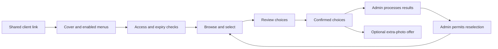
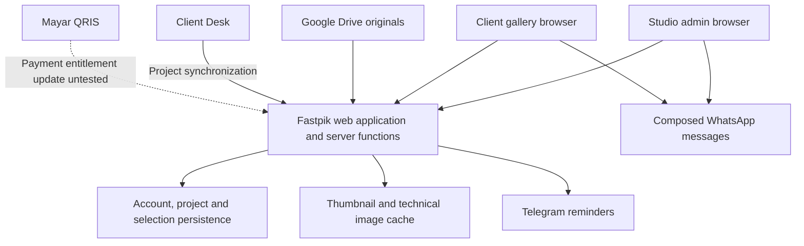

# Fastpik website audit

Audit date: 12 October 2026, Asia/Makassar. Target: https://fastpik.id. Version displayed: **2.0.4**, released 5 October 2026.

## Executive assessment

Fastpik is a subscription service for photographers and studios to manage client photo selection, delivery, extra-photo requests, and print choices. Google Drive supplies the original photos; Fastpik adds a branded gallery, access rules, selection tracking, reminders, and communication templates. The primary paying user is the studio administrator. Their clients access project links without creating an account.

The product has a substantial configuration layer and integrations with Client Desk, WhatsApp, Telegram, and Mayar. Its central operational model is a project with independently enabled selection, download, extra-photo, and print workflows.

**Follow-up: project creation and the core client workflow now work in this account.** The initial `Project settings not found` blocker was resolved by saving the required vendor name and account defaults through Settings. A project was created from the user-provided Drive folder, and main selection, notes, confirmation, reselection, individual download, and extra-photo selection were tested. The initial error remains an onboarding finding, rather than a continuing creation outage. See the [live-test and inferred platform-admin analysis](fastpik-admin-logic-and-live-test.md) for the latest results and the likely operator workflow.

## Scope and evidence

Reviewed **18 distinct page routes, two additional project-form views, and all eight settings tabs**, using the live website and the supplied login. Also reviewed current public product descriptions, FAQ, release history, and available browser DOM/console evidence.

Evidence labels used below:

- **Observed:** page, control, value, or behavior inspected directly.
- **Documented:** stated by Fastpik's feature pages, FAQ, policies, or changelog; not exercised end to end.
- **Inferred:** a proposed interpretation of the product model or architecture.
- **Unverified:** insufficient access or data to establish behavior.

At the start of the audit, the supplied account had zero projects, a blank vendor name, and a seven-day trial displayed as 12–19 October 2026, with a 0/3 project quota. It exposed no platform-owner console. In the authorized follow-up, one project named **Fastpik Audit** was created. The user confirmed that separate platform-admin access is unavailable, so the platform-operator analysis is explicitly inferred.

The initial pass was read-only apart from unsaved form exploration. In the follow-up, the vendor name was saved as Jablay, one project was created with user-authorized dummy WhatsApp numbers, three main selections and one extra selection were confirmed, and one test note was saved. Reselection was tested and turned off again. One image was downloaded. No subscriptions were purchased, messages sent, integrations activated, or credentials changed. Printing remains disabled. Credentials are omitted from this report.

This is a product and observable-behavior audit. It does not establish backend security, load capacity, database design, or complete coverage of undiscoverable routes.

## Initial page and feature coverage

This table records the first pass. The linked follow-up report adds live project detail/edit, client gallery, review, confirmation, download and extra-selection coverage, superseding the corresponding initial limitations below.

| Page / view | Purpose and observed features | Coverage |
|---|---|---|
| [Home](https://fastpik.id/id) | Product positioning, vendor logos, problems, features, screenshots, comparison, workflow, pricing and FAQ anchors; signed-in dashboard CTA | Observed |
| [Features](https://fastpik.id/id/features) | 19 advertised features; comparison; trial CTA | Observed; feature execution varies |
| [Pricing](https://fastpik.id/id/pricing) | Trial, monthly/quarterly/yearly Pro plans, Fastpik/Bundle tabs, session-aware purchase buttons, Client Desk bundle link | Observed; checkout not submitted |
| [FAQ](https://fastpik.id/id/faq) | Accordion help for client access, Drive, formats, duration, mobile, trial, QRIS, support | Observed; selected answers expanded |
| [Terms](https://fastpik.id/id/terms) | Service, accounts, billing, content responsibilities, integrations and support; dated 10 August 2026 | Read; no legal compliance opinion |
| [Privacy](https://fastpik.id/id/privacy) | Account/project data, Google sign-in, Drive/cache, analytics, retention and deletion requests; dated 10 August 2026 | Read |
| [Login](https://fastpik.id/id/login) | Email/password, show password, remember-me, Google sign-in, recovery, registration, next-route handling | Email/password login successful; OAuth untested |
| [Register](https://fastpik.id/id/register) | Full name, email, password/confirmation, terms/privacy consent, Google registration | Form inspected; no account created |
| [Forgot password](https://fastpik.id/id/forgot-password) | Email-based recovery and expired activation/reset-link recovery; main-domain continuation notice | Form inspected; no email sent |
| [Dashboard](https://fastpik.id/id/dashboard) | Total/active/expired project counts, pending main/extra selections, seven-day expiry panel, five latest projects, create/batch shortcuts | Empty-account state observed |
| [Projects](https://fastpik.id/id/projects) | Empty state with single and batch creation; active/expired filtered links exposed by dashboard | Empty state observed; populated list untested |
| [Create project](https://fastpik.id/id/projects?action=create) | Client/Drive/WhatsApp fields, cover, layout, notes, feature toggles, quotas, durations and passwords | Form inspected; blocked by settings error |
| [Batch project](https://fastpik.id/id/projects?action=batch) | Multi-row creation, add row, advanced fields, vendor-name prerequisite, disabled save when incomplete | Form inspected; no submission |
| [Client edit status](https://fastpik.id/id/client-status) | Three status counters/filters, search field, Card/List controls, refresh; “Realtime + fallback 5 menit” | Empty state observed |
| [Extra-photo status](https://fastpik.id/id/extra-status) | Separate three-state extra-photo workflow with matching search/view/refresh controls | Empty state observed |
| [Settings](https://fastpik.id/id/settings) | General, Default Project, SEO, Menu Descriptions, Message Templates, Print, Client Desk, Telegram | All eight tabs inspected |
| [Profile](https://fastpik.id/id/profile) | Avatar-upload affordance, editable name, read-only email, membership/trial usage, save and password-reset controls | Observed; no changes submitted |
| [Package](https://fastpik.id/id/profile/package) | Current plan, trial dates, transaction reference, subscription history, change-plan link | Trial state observed |
| [Changelog](https://fastpik.id/id/changelog) | Release history through v2.0.4, including operational and integration rules | Read; historical statements treated as documentation |
| [Custom domain](https://fastpik.id/id/custom-domain) | Branding offer, setup pricing, domain-cost exclusion, support and Instagram contact | Observed; no purchase/contact |

Additional discovered surfaces:

- **Feedback:** sidebar link to `/api/feedback/bridge`; destination flow not followed or submitted.
- **Client project:** settings describe `/{locale}/client/{vendor-name}/{project-id}`. No actual authorized project URL was available. Examples were treated as examples, not navigated as real projects.
- **Project detail/edit, populated folder management, print-status page, spreadsheet import, gallery/review/confirmation/password screens:** documented in release history or public imagery, but inaccessible as working flows with this account state. Exact unseen URLs are not asserted.
- **English and themes:** language menu exposes Indonesian/English; theme menu exposes Light/Dark/System. Full translation parity and device coverage were not tested.

## Business logic: roles and responsibilities

| Role | Responsibilities | Evidence / limit |
|---|---|---|
| Visitor | Evaluate features and plans, read help, register/sign in | Observed |
| Studio administrator / photographer | Configure vendor defaults, create and organize projects, share access, monitor selections, obtain results, manage subscription | Observed controls plus documented populated-project behavior |
| Client | Open link, pass any menu-specific password, choose/review/confirm photos, add permitted notes, download, choose extras or prints | Documented; public preview inspected, live flow untested |
| Freelance photographer | Receive RAW-file requests for selected images | Message-template option observed; full workflow documented |
| Fastpik platform operator | Operate plans, tenant infrastructure, integrations, support and custom-domain setup | Business responsibility inferred; no operator console inspected |

“Admin” in the inspected UI means the studio's operational administrator. The supplied login does not establish platform-superadmin permissions, team roles, or staff-access controls.

### Commercial model

| Offering | Displayed terms |
|---|---|
| Trial | Seven days, at most three projects, unlimited photos including subfolders; no card required |
| Pro, one month | Rp29,000 |
| Pro, three months | Rp79,000 |
| Pro, one year | Rp289,000 |
| Pro benefits | Unlimited projects/photos, full Pro access and priority support |
| Renewal | Manual payment; no automatic debit. An active subscription's expiry is extended by the purchased duration |
| Payment | Mayar, QRIS only; pricing instructs buyers to use the account email |
| Bundle | Pricing redirects users to Client Desk's bundle offerings; bundle prices were not audited |
| Custom domain | Rp200,000 promotional setup price against Rp400,000, advertised for the first ten customers; once paid, setup applies to Fastpik and Client Desk; domain registration excluded |

The domain popup displayed eight slots used and two remaining. This is a time-sensitive sales display, not independently verified inventory. Historical domain prices in the changelog are not current offers.

The terms state that successful payments are generally nonrefundable subject to their stated exceptions. Payment settlement, webhook delivery, incorrect-email recovery, refunds, plan expiry, and reactivation were not exercised.

### Studio-admin workflow

1. **Authenticate and establish entitlement.** Access the studio dashboard; profile/package screens show trial or subscription status and usage.
2. **Configure the studio.** Set vendor name and default WhatsApp number, then project defaults, messages, print templates and optional integrations. Batch creation explicitly requires the vendor name for branded client URLs.
3. **Prepare the source.** Add a Google Drive folder. The form instructs the owner to share it as “Anyone with the link” with Viewer access. Subfolder detection is optional. This is separate from Fastpik's own folder hierarchy.
4. **Create a project.** Supply client/source details and enable the required client menus. Single-project settings include cover behavior, Grid layout default, photo notes, WhatsApp client/admin, selection quota, separate duration/password controls, extra photos and prints.
5. **Distribute access.** Use client links and WhatsApp templates. The UI supports WhatsApp app/Desktop versus Web preference. Sending a composed WhatsApp message should not be confused with automatic message delivery.
6. **Track activity.** Dashboard aggregates expiry and pending work. Main and extra-photo selections have separate status pages. Print tracking is documented and controlled by the global print setting.
7. **Process results.** Documented actions include review, copy file lists, confirm on the client's behalf, reopen confirmed choices, and request RAW files from a selected freelancer.
8. **Follow up and renew.** Telegram sends configured expiry reminders to the configured chat. Admins can prepare WhatsApp follow-ups. Subscription renewals are manually purchased.

### Client workflow and state rules

This diagram is a synthesis of inspected configuration and Fastpik's documentation, not an end-to-end execution trace.

The displayed operational states are **Not selected → Selecting → Confirmed**, independently tracked for main and extra selections. Release notes document equivalent print states, locking after confirmation, and reopening without deleting previous choices. Vendor confirmation is allowed when a client confirms outside Fastpik, such as via WhatsApp.

The client portal can expose four independent functions:

| Function | Principal business rules |
|---|---|
| Main selection | Maximum selection quota; optional per-photo notes; review and confirmation; configured expiry/password |
| Download | Independently enabled; separate expiry/password; individual and bulk/ZIP download documented |
| Extra photos | Additional choices beyond initial selection; can be offered after main confirmation if enabled; independent access constraints documented |
| Print | Globally enabled first, then project configuration; reusable size/quota templates; optional requirement to fill every print-size quota before confirmation |

Documented validation details worth preserving in any implementation:

- Main selection quantity is required only when that menu is active; download-only or print-only projects do not need it.
- Each client menu can have its own password; sharing the main-selection password is an explicit convenience option.
- Selection and download expiry are independent. Common duration choices are forever, 1/3/5/7/14/30 days, or custom.
- Confirmed choices remain locked until the administrator allows reselection.
- Photo identity must include the underlying file/folder identity, not just filename; release notes explicitly address duplicate names.
- Global defaults seed new projects. Per-project settings can diverge; photo-note help explicitly says changing a project's setting does not change existing projects.
- Project-folder nesting is capped at five levels; invalid folder moves are documented as blocked.
- Limits and defaults must also apply to batch/import/Client Desk entry paths, not just the single-project form.

## Feature inventory beyond the main workflow

### Settings

| Tab | Inspected configuration |
|---|---|
| General | Default admin WhatsApp and delivery app preference; vendor name; bilingual client landing text; post-confirmation extra-photo offer toggle; which duration appears on project cards |
| Default Project | Default enabled menus; quota; selection/download durations and password reuse; subfolder detection; initial layout; photo notes |
| SEO | Client-page title, description, keywords; vendor/tenant/client/project/locale tokens; automatic fallback when empty |
| Menu Descriptions | Separate Indonesian and English descriptions for selection, download, extras and print |
| Message Templates | Template selector, language tabs, variables, editor and preview |
| Print | Global enable switch; named templates containing size and quota rows; add-size/add-template controls; default print-link duration |
| Client Desk | Enable integration, status, API-key generation affordance, last-sync log and status; currently inactive |
| Telegram | Setup links, chat ID, reminder type, days before expiry, language and test-message button |

Message-template categories observed: main-selection link, download link, extra-photo link, initial results, extra results, RAW request, and reminders for selection/download/extras. Selected link-template tokens included client name, link, count, password and duration. Print-specific messaging is documented but was not exposed while printing was disabled.

Telegram's visible reminder choices were H-1, H-3, H-5, H-7 and H-14; H-3/H-7 were selected in the displayed default form. Reminder type supports selection, download, or both. The test button was disabled without a chat ID.

### Documented project and gallery capabilities

- Spreadsheet-style batch entry and CSV/Excel import.
- Project folders, nested organization, breadcrumbs, drag-and-drop and bulk management.
- Filters across folders for expiry, enabled features and selection status.
- Cover selection, crop/position/zoom, and Drive-folder navigation for cover choice.
- Grid and Masonry photo layouts; filename display in Grid.
- Photo zoom, swipe, pinch and review gallery.
- Client help per menu; manual gallery refresh.
- File lists grouped by print size or prior/additional selection, including photo notes and source folder context where appropriate.
- iOS saving of up to ten selected photos to Photos, with ZIP as another option.
- In-app notifications for link expiry and subscription events.

These are supported by the [feature catalog](https://fastpik.id/id/features) and [changelog](https://fastpik.id/id/changelog). A release note confirms intended behavior at release time, not that every current edge case passes.

## Technology and architecture

### Evidence-based technology assessment

| Component | Evidence | Confidence / boundary |
|---|---|---|
| Next.js | Loaded `/_next/static/chunks/…` assets and `/_next/image` image URL | Strong frontend fingerprint; exact version unknown |
| React | Next.js application plus React-style Radix identifiers | Strong inference; exact React version unverified |
| Turbopack | Loaded chunk named `turbopack-…js` | Direct asset-name evidence |
| Radix UI | `radix-…` IDs on dialogs, tabs and menus | Strong component-library fingerprint |
| Tailwind CSS | Utility classes such as `dark:…`, `size-9`, `focus-visible:…`, arbitrary selectors | Strong styling fingerprint; version unknown |
| shadcn/ui | Button conventions and Radix/Tailwind combination resemble shadcn | Plausible inference only; not proven |
| Lucide | SVG classes such as `lucide-layout-dashboard` and `lucide-settings` | Direct DOM evidence |
| Geist / Geist Mono | Font-module classes on the document body | Direct DOM evidence |
| Supabase Storage | Changelog v1.4.5 explicitly identifies avatar storage URLs | Vendor-documented; does not prove all auth/database services use Supabase |
| Umami | Privacy declaration and loaded `umami.ryanekoapp.web.id/script.js` | Direct asset plus documentation |
| Cloudflare | Loaded analytics beacon and Turnstile-origin entries in browser logs | Scripts/service use observed; origin hosting/WAF rules not established |
| Nginx, SSL, DNS | Custom-domain setup page names these | Vendor-documented setup stack, not server inspection |
| Google Drive | Project source field, sharing requirements, FAQ and privacy page | Observed integration design; live photo retrieval untested |
| Mayar / QRIS | Pricing and terms identify processor/payment method | Documented; settlement not tested |
| WhatsApp / Telegram | Template and reminder configuration, bot links | Observed integration surfaces; no outgoing messages tested |
| Client Desk API | Integration settings; changelog documents ping, API key, source-reference upsert and sync status | UI observed; protocol behavior documented, not called |

The frontend does not reveal enough to assert backend language/runtime, database engine/schema, deployment provider, authentication provider, queues, cron implementation, object-cache vendor, or exact dependency versions. Cloudflare scripts do not by themselves prove Cloudflare hosts the application. Supabase Storage usage does not by itself prove Supabase Auth/Postgres usage.

### Inferred system boundaries

This is a conceptual architecture. The privacy page describes source photos remaining in Drive and technical image copies being cached. The status UI advertises realtime updates with a five-minute fallback. Neither the realtime transport nor cache topology was verified.

Client Desk release notes describe idempotent upsert by source reference, source metadata to prevent duplicate projects, creation at root, and updates restricted to core fields to preserve manual Fastpik presets. Sync statuses include idle, syncing, success, warning and failed. Freelancer information is documented as a per-project snapshot with a maximum of five people.

### Proposed domain model

The following entities are an analytical model, not extracted database tables:

| Entity | Likely responsibility |
|---|---|
| Account / studio / tenant | Identity, vendor slug, preferences and branding |
| Subscription / transaction | Entitlement, trial, start/end dates and payment history |
| Project | Client, Drive source, contact details, enabled workflows and per-menu rules |
| Project folder | Parent-child organization, subject to depth/move constraints |
| Photo reference | Stable Drive file identity, folder context, filename and cached representation |
| Selection / note / confirmation | Per-project, per-workflow choices and state |
| Print template / size quota | Reusable print package and project-specific requirements |
| Message template | Purpose, locale, variables and body |
| Integration / sync reference | Client Desk identity, key lifecycle and synchronization result |
| Notification / reminder | Trigger, delivery target, due time and read/delivery state |

Do not assume individual client accounts exist: Fastpik explicitly describes account-free client access through links.

## Findings and priorities

### P1 — Incomplete onboarding blocks project creation; workaround verified

**Observed:** after successful login, Dashboard → Create Project displayed an account-settings error, disabled fields and disabled “Buat Link.” “Muat ulang pengaturan” briefly changed the message to loading, then returned to failure. Console evidence: `Failed to load project settings: Error: Project settings not found`.

**Impact:** this account cannot reach the product's primary activation event through single-project creation. Batch creation separately identifies the missing vendor name; the single form does not provide that same guided setup path.

**Recommended fix:** investigate account provisioning and settings retrieval. Create required settings idempotently during onboarding, distinguish missing rows from request/auth failures, and offer an explicit vendor-setup step. Do not enable saving with unknown security-sensitive defaults. Verify both fresh email/password and Google accounts, plus existing accounts with missing settings.

**Follow-up resolution:** saving the vendor name and account defaults through Settings made the single-project form usable and creation succeeded. The likely problem is incomplete initialization or an unclear onboarding dependency. Exact database/root cause remains unverified.

### P2 — Unresolved trial placeholders on the feature page

**Observed twice:** the feature-page CTA displayed literal `{days}` and `{projects}` placeholders, while the homepage/pricing showed seven days and three projects.

**Impact:** broken offer copy at a conversion point and inconsistent presentation of trial limits.

**Recommended fix:** pass the trial parameters to this localized message and validate the CTA in both languages against the same entitlement configuration.

### Investigation — Session continuity during direct navigation

**Observed:** after the first login, opening settings in another tab and directly navigating the original tab to the batch URL produced login screens. A second login restored access; subsequent internal navigation and some public-page session recognition worked.

**Interpretation:** session persistence or initialization timing needs reproduction in a normal browser. Browser automation/session behavior is also a possible factor. This is not classified as a confirmed sitewide authentication defect.

**Check:** hard refresh, new tab, bookmarked protected route, and session restoration with remember-me both off and on; preserve the requested destination.

### P2 recommendation — Make incomplete onboarding explicit

General settings appeared usable with empty configuration, while project creation treated settings as unavailable and batch creation required a vendor name. Present a single setup-status explanation with the missing prerequisite and a direct action. Do not silently make an incomplete account look fully ready.

### Product and security boundaries requiring validation

These are test priorities, not discovered vulnerabilities:

- **Drive access:** Fastpik password/expiry gates do not change the permission of a publicly shared source Drive folder. Clarify this boundary to studios and test whether original links or metadata reveal more than intended.
- **Selection integrity:** verify quotas and confirmation locks on the server, including two browser tabs, duplicate filenames, reconnects, and expired links.
- **Tenant isolation:** test project, image, result, notification, custom-domain and integration access across two authorized test tenants.
- **Billing integrity:** verify duplicate/delayed payment callbacks, account matching, renewal arithmetic, expiry gating and reactivation.
- **Sync integrity:** repeated Client Desk upserts should not duplicate projects or overwrite project-specific presets; subscription limits should apply consistently.
- **Client-page privacy:** SEO customization exists, but indexing policy for personal galleries was not established. Inspect robots directives and share previews, especially on protected galleries.
- **Scale and reliability:** no performance benchmark was run. Test large Drive folders, cache misses, source permission changes, bulk downloads and partial image failures.

## Initial validation plan and follow-up status

The follow-up completed main selection, note persistence, confirmation, reselection with retained choices, one individual download, and one extra-photo confirmation. Large ZIP downloads, printing, password/expiry enforcement, batch import, integrations, payment, platform-owner access and a cross-device matrix remain untested. The table below is retained as the original test plan, not a claim that every listed group is still wholly untested.

| Test group | Needed access/data | Success criteria |
|---|---|---|
| Main selection | Working project with test photos | Select within quota, add notes, refresh/reconnect, review, confirm; results match admin view |
| Reopen | Confirmed test selection | Admin reopens without deleting choices; changes then reconfirm correctly |
| Extra photos | Extras-enabled project | Correct prior/extra separation, quota, access rules and offer behavior |
| Print | Printing enabled in a test account | Per-size quotas, incomplete/full confirmation modes, grouped results |
| Downloads | Several file types and sizes | Individual/ZIP downloads, expiry/password gates and iOS behavior |
| Batch/import/folders | Test workspace with configuration initialized | Validation, partial failures, nested folders, depth/cycle prevention and move persistence |
| Integrations | Authorized test Drive, Client Desk and Telegram setup | Correct sync/reminder behavior without duplicate actions |
| Billing | Payment sandbox or approved test purchase | Entitlement updates once, correct dates and history |
| Platform administration | Separate authorized operator access | Tenant/user management, plans, billing support, domain setup, audit logs and operational controls |
| Accessibility/mobile | Device/browser matrix | Keyboard access, labeled controls, focus, overflow, gallery gestures and readable layouts |

The created [audit gallery](https://fastpik.id/id/client/jablay/zTFMuj9JQNDV) now supplies the client test case. Platform-owner features are analyzed by inference because separate operator access is unavailable. No hidden admin routes or other customer galleries were guessed or enumerated.

## Source index

- Product: [Home](https://fastpik.id/id), [Features](https://fastpik.id/id/features), [FAQ](https://fastpik.id/id/faq).
- Commercial: [Pricing](https://fastpik.id/id/pricing), [Package](https://fastpik.id/id/profile/package), [Custom domain](https://fastpik.id/id/custom-domain).
- Operations: [Dashboard](https://fastpik.id/id/dashboard), [Projects](https://fastpik.id/id/projects), [Selection status](https://fastpik.id/id/client-status), [Extra status](https://fastpik.id/id/extra-status), [Settings](https://fastpik.id/id/settings).
- Rules and implementation statements: [Changelog](https://fastpik.id/id/changelog), [Privacy](https://fastpik.id/id/privacy), [Terms](https://fastpik.id/id/terms).

Authenticated links require an authorized login. Findings are a snapshot of this account and the site on the audit date.
